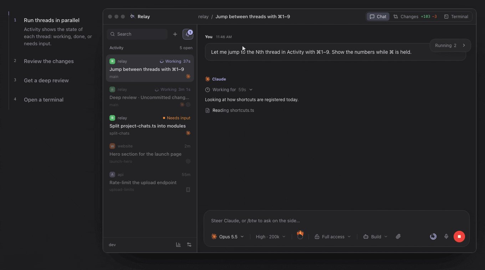

<h1 align="center">Relay</h1>

<p align="center">
  <strong>One workspace for your coding agents.</strong><br>
  Claude, Codex, OpenCode, Cursor, Amp, Antigravity and agents from the ACP registry, using your existing agent accounts.<br>
  Open source (MIT) for macOS, Windows and Linux, with a phone companion and a headless mode for servers.
</p>

<p align="center">
  <a href="https://relaycode.io/download/"><strong>Download</strong></a>
  ·
  <a href="https://relaycode.io">Website</a>
  ·
  <a href="#how-relay-compares">How it compares</a>
  ·
  <a href="#for-contributors">Build it yourself</a>
</p>



## Get started

Relay is an **early preview**. Grab your build from the [latest release](https://github.com/relaycodehq/relay/releases/latest). This README describes the current source, including changes that may not be in that release yet.

| System | Download | Status |
| --- | --- | --- |
| macOS (Apple Silicon) | `Relay-<version>-mac-arm64.dmg` | Used daily. Ad-hoc signed, not notarized. |
| Windows 10/11 (x64) | `Relay-<version>-win-x64.exe` | Built every release, less daily use. |
| Linux (x86-64) | `Relay-<version>-linux-x86_64.AppImage` | Cross-built, thinly tested on real distributions. |
| Omarchy | `Relay-<version>-omarchy-x86_64.tar.gz`, then `python3 install.py` inside it (no sudo) | As Linux. |
| Android | `Relay-Android.apk`, or **Settings → Phone → Get the app** on the desktop | Companion app; needs a running desktop or headless Relay. |

1. Set up at least one agent under **Settings → AI & agents → Agents**. Relay can install missing CLIs and uses existing sign-ins for [Claude Code](https://code.claude.com/docs/en/overview), [Codex](https://github.com/openai/codex), [OpenCode](https://opencode.ai) and [Amp](https://ampcode.com). Cursor, Antigravity and ACP registry agents can be installed and signed in there too.
2. Add a project folder, use **Scratchpad** for work without a project, or run `relay .` in a folder (choose **Relay → Install "relay" Command…** once on macOS or Linux).
3. Type what you want done, pick the agent and model, and press **Send**.

No Relay account or Relay subscription. Agents use their own subscriptions, credits or API keys; their billing and limits still apply. Installed desktop builds check for updates and offer **Restart** to install them.

For a server or a spare computer, like an old desktop in a cupboard, the [headless Relay](docs/headless.md) installs with one command, sets up a background service and pairs with your phone:

```console
curl -fsSL https://relaycode.io/install.sh | sh
```

> [!NOTE]
> macOS builds are ad-hoc signed, without Apple notarization; Windows installers are unsigned. First launch may need an extra step:
>
> - **macOS:** move Relay into **Applications** or another writable folder. Close the "can't verify" dialog, then **System Settings → Privacy & Security → Open Anyway** (or run `xattr -cr /Applications/Relay.app`). Updating won't work from the mounted disk image or a translocated download.
> - **Windows:** SmartScreen's "Windows protected your PC" → **More info → Run anyway**.
> - **Linux:** `chmod +x` the AppImage. Some distributions need their FUSE compatibility package.

## How Relay compares

People choosing between these apps tend to ask three things: can I use the subscription I already pay for, can the agents run on another machine, and can I follow and answer them from my phone. Relay supports all three without a Relay fee, account or hosted service between your devices:

- **Your agents.** Relay connects through each agent's CLI, SDK or ACP server using its own authentication. Run several agents side by side, switch agent mid-thread, and choose between saved Claude or Codex accounts.
- **Remote.** Hand a thread to another desktop or headless Relay, including its uncommitted work, and bring it back later. On current versions, keep chatting, steering and answering approvals from the original computer while the other one runs it.
- **Mobile.** The Android app, and experimental iOS source build, connect over your own Tailscale or an explicitly enabled local network. The connection is end-to-end encrypted. Start threads, answer approvals, dictate, listen to answers, review and commit.

| | Your subscriptions | Agents on another machine | Phone | Source |
| --- | --- | --- | --- | --- |
| **Relay** | Claude, Codex, OpenCode, Cursor, Amp, Antigravity, ACP registry. Free app | Desktop or headless Relay on your box; live thread handoffs | Android; iOS from source. Tailscale or opt-in LAN | MIT |
| [T3 Code](https://github.com/pingdotgg/t3code) | Many vendors, ACP. Free | SSH, Tailscale or pairing; optional hosted tunnel | Native iOS and Android, direct or via their tunnel | MIT |
| [Jean](https://jean.build) | Many vendors. Free | Headless Linux server; local and remote projects together | Web UI served by desktop or server | Apache-2.0 |
| [Conductor](https://www.conductor.build/) | Claude Code, Codex, OpenCode, Cursor. Free tier; paid Pro | Their managed cloud (Pro) | iOS (Pro) | Proprietary |
| [Superset](https://superset.sh) | Many CLI agents. Free local use; paid Pro | Your host through their hosted relay (Pro) | iPhone and iPad, via their relay (Pro) | ELv2, source-available |
| [Claude Code desktop](https://code.claude.com/docs/en/desktop) | Claude subscriptions | SSH or Anthropic's cloud | Claude app, via Anthropic | Proprietary |
| [ChatGPT desktop / Codex](https://learn.chatgpt.com/docs/app) | ChatGPT plans | SSH or Codex Cloud | ChatGPT app, via OpenAI | Desktop proprietary; Codex open-source components |

Relay combines thread handoffs between your own computers with deep reviews where a lead checks findings from several reviewing models before fixing what holds up. It has no managed cloud sandboxes, and iOS still requires a source build.

<sub>Documentation checked 11 October 2026; these are published capabilities, not a hands-on comparison. Sources: [T3 remote access](https://github.com/pingdotgg/t3code/blob/main/docs/user/remote-access.md), [Jean](https://github.com/coollabsio/jean), [Conductor plans](https://www.conductor.build/pricing), [Superset remote access](https://docs.superset.sh/remote-access) and [plans](https://superset.sh/pricing), [Claude desktop](https://code.claude.com/docs/en/desktop), [ChatGPT remote connections](https://learn.chatgpt.com/docs/remote-connections). Agent subscriptions are separate from app pricing. Something out of date? [Open an issue](https://github.com/relaycodehq/relay/issues/new/choose).</sub>

## What it does

| | |
| --- | --- |
| **Run many threads at once** | Activity shows which thread is working, done or needs you, including threads started by an agent. Jump between cards with Cmd/Ctrl+1–9, snooze or settle them, or pop a thread into its own window. |
| **Watch every step** | Commands, reads, edits and subagents appear live, then fold away when the answer lands. |
| **Steer, queue and ask aside** | Steer a running agent where supported, queue messages or schedule a send. Fork a conversation, reply to an answer, or use `/btw` for a side question. |
| **Keep work moving** | `/goal` exposes Claude and Codex's native goals. `/resume` continues their terminal sessions in Relay. Hosted agent sessions can survive a Relay restart. |
| **Keep what matters** | Pin a whole answer, selected text, a list, code or a table to thread notes. Tick off and reorder checklist items, quote unfinished work, or jump back to the source answer. |
| **Review edits** | Inspect working-tree and per-turn diffs beside the conversation; roll back or redo a turn's edits. Stage, commit, split changes into commits and push; browse history in a commit graph. |
| **Deep review** | Pick changes, a branch, a commit or a PR. Several reviewers read the code, then a lead checks their findings and fixes what holds up. Save setups for reuse. |
| **Work in isolation** | Give a thread a Git worktree, even mid-conversation, carry selected uncommitted changes with it, and merge its branch back. Git, Files and future turns follow the selected workspace. |
| **Edit and check files** | Browse and find files by name, edit with syntax highlighting, and preview Markdown. Supported TypeScript/JavaScript and Angular projects get language checks, definitions and usages. |
| **Use a terminal** | Each thread has its own shell; Tasks shows processes agents left running, with stop and restart controls. |
| **See the result** | Open a browser preview beside the thread. Agents can show interactive pages and visual choices inline; the Device tab embeds Android emulators and iOS simulators through Expo Device Hub. |
| **Review pull requests** | GitHub through your `gh` login, Azure DevOps through your `az` login, or Gitea, with CI status in the title bar. |
| **Speak and listen** | Dictate messages and have answers read aloud using downloaded models on your computer. Phones use that same computer's speech engines over the encrypted connection. |
| **Keep an eye on usage** | Claude and Codex plan meters, weekly pacing around your working hours, recorded token usage and cost estimates, and measured writing speeds for Claude and Codex. |
| **Make it yours** | Built-in themes or imported VS Code colour themes from Open VSX, fonts, interface scale, keyboard shortcuts and notification sounds. Optional plugins add Clockify time tracking and Azure DevOps work items. |

For remote work, both computers need the repository cloned and added to Relay with a matching Git remote. **Settings → Computers** pairs them. A live handed-off thread's **Files**, **Changes** and diffs still show this computer's checkout. If the other computer goes offline, messages wait for it; **Run here instead** continues with the conversation available here, leaving that computer's later code changes there. Bringing work back normally transfers those changes too.

Phone access starts in **Settings → Phone**. Tailscale is the default; **Local network** is off until you enable it for devices on the same network. The computer must remain running and reachable. The Android app can notify you in the background; there is no iPhone app yet. See the [phone guide](docs/phone.md) for setup.

## Good to know

- Relay runs agent software on your computer; prompts, selected files and other context go to the providers configured in those agents. Helper jobs such as titles, commit messages and reviews also use agents. There is no Relay-hosted model service.
- **Relay counts its users.** Once a day each copy tells `ping.relaycode.io` it is in use: its version, the system and whether it is desktop or headless. There's no ID and the address isn't kept, so it only says how many people use Relay that day; the [Worker](ping/worker.js) is all there is to it. Turn it off with **Count me as a user** in Settings → About, `relay settings set usage-ping off`, `"usagePing": false` in settings.json, or `DO_NOT_TRACK=1`. That ping is Relay's only telemetry: [every host Relay talks to](docs/network.md) is listed with what it's for, and a test fails if the code names one that isn't.
- Desktop threads, drafts and settings are stored in `~/Library/Application Support/Relay Experimental` (macOS), `%APPDATA%\Relay Experimental` (Windows) or `~/.config/Relay Experimental` (Linux, or your XDG config directory). Headless Relay uses `~/.relay`. Chat history isn't encrypted at rest; pairing and handoffs copy relevant data to your other devices.
- Desktop secrets use OS-backed encryption where available; agent CLIs also manage their own credentials. Without an available encryption backend, the bridge key and paired-computer tokens can be saved unencrypted. Headless Relay encrypts its secrets with a local key file; see [its security notes](docs/headless.md#security).
- **Fresh threads start on Auto-accept edits,** then on whichever access mode you last used. Agents can edit files and run commands, including Git, within the selected permission mode. Relay also changes Git state as part of requested worktree, merge and handoff operations; handoffs commit uncommitted work for transfer. A worktree separates checkouts; it is not a security sandbox.
- Relay is independent and not affiliated with OpenAI, Anthropic, Google, OpenCode, Cursor (Anysphere), Amp or the makers of other agents it runs. Cursor's SDK isn't part of Relay: it is downloaded from npm when you ask, under Cursor's Terms of Service.

## Documentation

- [Project workspace](docs/project-workspace.md): threads, notes, worktrees, goals, agents, permissions and composer commands.
- [Phone app](docs/phone.md): pairing, what the phone can do, and how the connection is secured.
- [Headless Relay](docs/headless.md): Relay without its window on a server or a spare computer.
- [Pull request review](docs/pr-review.md): the review workflow, grouping and live checks.
- [Browser previews](docs/previews.md): preview sessions and existing dev servers.
- [Network](docs/network.md): every host Relay connects to, when, and what turns the automatic ones off.
- [Development and releases](docs/development.md): tests, packaging, updates and release status.

## For contributors

See [CONTRIBUTING.md](CONTRIBUTING.md) for the development workflow, code conventions and pull request guidance. To report a vulnerability privately, follow [SECURITY.md](SECURITY.md). Adding an agent? Start with the [agent adapter architecture](docs/agent-adapters.md).

```console
npm ci
npm run dev
```

You need Node.js 22+ and Git. Packaging the Omarchy bundle also needs Python 3; building the Android app needs JDK 21 and the Android SDK ([phone guide](docs/phone.md#try-it-from-source)).

Run `npm run typecheck` for all TypeScript projects and `npm run test:setup` once before `npm test` to install the isolated language-test toolchain. `npm run test:e2e` drives the real Electron app with hidden windows. `npm run package:mac` (or `win`, `linux`, `omarchy`, `headless`) writes packages into `release/`; cross-platform packaging has additional dependencies described in [development and releases](docs/development.md). An annotated `v<major>.<minor>.<patch>` tag on `main` triggers the Mac mini's release build; pushing to `main` alone ships nothing.

<details>
<summary><strong>Refresh the README demo and the teaser</strong></summary>

Both are recorded from preview pages that render the app's own components on sample data. With the dev server on port 5177, `ffmpeg` and `gifsicle` installed:

```console
node scripts/record-readme-demo.mjs   # docs/media/relay-demo.gif, one loop of the website's tour
node scripts/record-teaser.mjs        # test-results/teaser/, 1080p60 (--scale 2 for 4K)
```

</details>

## Troubleshooting

- **An agent isn't found:** Relay reads your login shell's `PATH`. Check **Settings → AI & agents → Agents** to install it or link its executable; restart Relay after changing your shell setup.
- **An agent says it's signed out:** use its account controls under **Settings → AI & agents → Agents**, or its CLI login command for the account the thread uses.
- **macOS keeps asking for Keychain access:** ad-hoc signed builds can ask again after an update. Denying access can prevent Relay from unlocking saved integration credentials or device pairing secrets.
- **The update doesn't install on macOS:** move `Relay.app` into **Applications** (or any writable folder) and try again.
- **Linux won't start:** check that user namespaces are enabled for Chromium's sandbox. Don't disable the sandbox instead.
- **A phone can't connect:** keep its computer awake and Relay running. Use the same Tailscale network, or enable **Settings → Phone → Local network** and join the same LAN.
- **A thread's selected agent worktree was deleted:** use **Recreate worktree** if its branch still exists, or **Continue in checkout**. Recreating restores committed files from the branch, not lost uncommitted edits.
- **Corrupt state:** Relay keeps the unreadable file and reports an error rather than overwriting it. Back up the data folder before repairing it.

## Contact

Questions or setup help: [hello@relaycode.io](mailto:hello@relaycode.io). For bugs and feature requests, use the [issue forms](https://github.com/relaycodehq/relay/issues/new/choose). Report suspected vulnerabilities privately using [SECURITY.md](SECURITY.md); keep exploit details out of public issues. Pull requests are welcome; see [CONTRIBUTING.md](CONTRIBUTING.md).

## License

Relay is released under the [MIT License](LICENSE). You can use, modify and redistribute it, including commercially, as long as the copyright and license notice stay with it.

Copyright (c) 2026 Relay contributors

Third-party components keep their own licenses; they are listed in [THIRD_PARTY_NOTICES.md](THIRD_PARTY_NOTICES.md).
