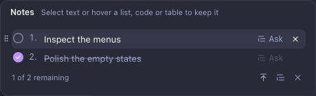
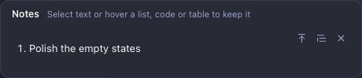
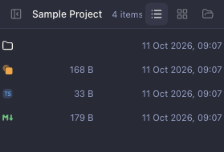
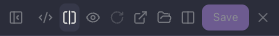
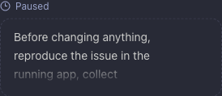
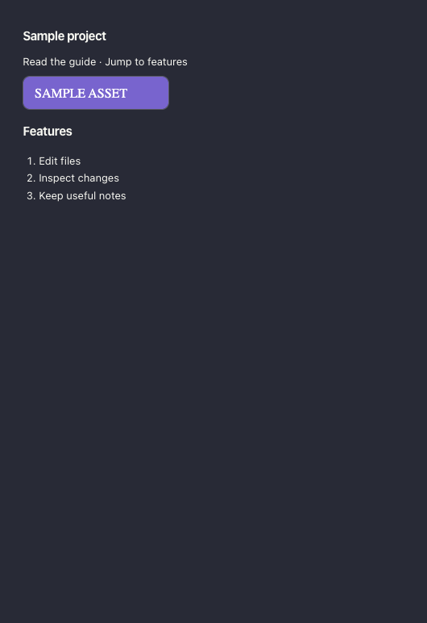
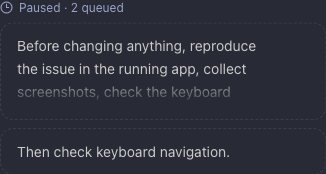
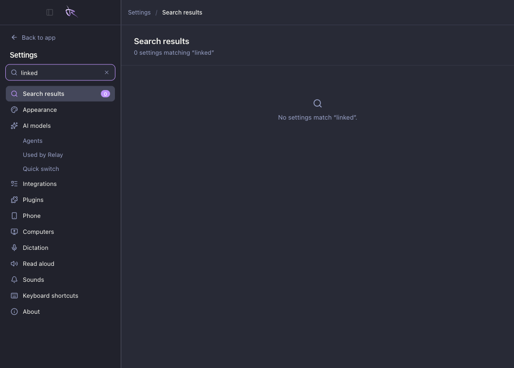

# Relay usability audit — 11 October 2026

Five bug groups were reproduced in the desktop UI, traced to their shared causes, and reproduced again with the current components on sample data. The report also includes three working polish concepts and one discovery improvement. No product fixes were made.

Open `previews/audit-usability-2026-10-11/` on the existing dev server. It has screenshots, reproduction steps, live component demos and polish options. Everything interactive uses sample data.

## Recommended order

1. Preserve completion when a Notes list shrinks to one item.
2. Keep filenames visible in narrow Files viewers and editor bars.
3. Repair dragging between queued messages of different heights.
4. Re-measure queued messages when their width changes.
5. Make Markdown document links and section anchors work.

All five are P2: ordinary interactions produce incorrect state or block useful navigation/reading. None was established as a crash or data-loss incident affecting project files.

## B1 — Deleting neighbouring note items loses completion

**Reproduction**

1. Pin a list of at least two items.
2. Tick the item you intend to keep.
3. Remove the other items until only the completed one remains.
4. Use the quote action.

**Observed:** the checkbox and crossed-out styling disappear. Quoting inserts the completed item into the draft. The remaining item is still saved, but its completion state is discarded.

**Expected:** deleting other items must preserve whether the surviving item is complete. It should remain excluded from a quote until explicitly unticked.

**Cause:** `noteList()` rejects lists with fewer than two items in `shared/thread-notes.ts:93`. `arrangeNote()` then clears `done` when the result is no longer recognised as a list (`shared/thread-notes.ts:228`). `noteQuote()` treats the resulting plain note as quotable without applying the completion filter (`shared/thread-notes.ts:100`). The fix belongs in the shared note representation/transform, so the desktop and agent-facing view agree.

**Evidence:** actual Notes controls and quote action were exercised in isolated Electron. The browser demo uses the same `NotesChip`, `arrangeNote`, `tickNote` and quote code.

[Full screenshot: completed note included in the draft](evidence/08-completed-note-quoted.png).

This contradicts the behaviour requested in “Make paste skip crossed-out items and improve pinning” and implemented in `c6d1714e`.

## B2 — Narrow Files views lose the useful labels

**Reproduction**

1. Keep sidebar, chat, Files and its file tree open.
2. Resize the main window to 1060 × 760. Its supported minimum width is 1050 (`electron/app/window.ts:191`).
3. Browse the project root, then open `README.md`.

**Observed:** in a 279 px file viewer, all four folder-row filename spans measure **0 px**. Sizes and dates remain visible. The editor's path container also measures **0 px**, while the toolbar keeps all its remaining action buttons. The unsaved-state label and its dot are hidden by the narrow-container rule.

**Expected:** filenames and at least a small unsaved indicator have priority over metadata and secondary controls.

**Causes:**

- Folder rows use `14px 1fr 80px 150px` plus gaps and padding. The name is the only flexible column (`src/features/files/file-browser.css:160`).
- The editor path gets the remaining space after its actions (`src/ui/workspace-panes.css:285`); there is no narrow-width overflow menu. `src/ui/workspace-panes.css:410` hides the entire state indicator.

These are two related layout failures grouped under one user-visible issue. Fixing the folder grid alone will not repair the toolbar.

[Full folder screenshot](evidence/11-folder-names-lost.png) · [Full editor screenshot](evidence/10-toolbar-clipped.png).

This is directly adjacent to the filename visibility work in `b989ae9e`.

## B3 — A queued message can be clipped but impossible to expand

**Reproduction**

1. Queue text that fits within three lines in a wide chat.
2. Open a side pane or narrow the window so the text needs more lines.
3. Click the queued bubble.

**Observed:** the body is clipped but the bubble does not expand. In the desktop run:

- Wide bubble: text visible/full height **46 / 46 px**.
- Narrow bubble: **74 / 208 px**.
- After clicking: still **74 / 208 px**, with no `open` class.

The text remains stored and can be returned to the composer. This is a reading/expansion defect, not a message-loss claim.

**Cause:** `QueuedRow` measures overflow only when `text` or `open` changes (`src/features/thread/QueuedMessages.tsx:89`). A pane resize does not update `long`. The click handler checks that stale value (`src/features/thread/QueuedMessages.tsx:109`). Shared `QueuedRow` also renders scheduled messages, so the same component needs the fix; scheduled-message delivery was not separately tested.

[Wide screenshot](evidence/12-queue-wide.png) · [Narrow screenshot](evidence/13-queue-cannot-expand.png).

The report demo reproduces this with the actual component. It also exposes the separate drag-height defect in B5. It does not replace the bubble design you picked in the queue discussion (`3b75d727`).

## B4 — Markdown preview drops local and section links

**Reproduction**

1. Open a Markdown file with `[Guide](docs/guide.md)` and `[Features](#features)`.
2. Choose Preview or Split.
3. Try clicking or tabbing to those links.

**Observed:** both become `` elements. The rendered preview contains **zero anchors** for them. Local images load correctly.

**Expected:** a relative document link opens the target file; a section link scrolls to the heading. If a target cannot be opened, the UI should say so.

**Cause:** `MarkdownPreview` supplies no local-link context or navigation callback to `RichText` (`src/features/files/editor/MarkdownPreview.tsx:161`). `RichText` turns links that are neither recognised project files nor external URLs into spans (`src/ui/RichText.tsx:351`). Heading anchor IDs are also absent. Simply giving the spans link colours would leave the underlying navigation broken.

[Full Split screenshot](evidence/03-readme-links.png).

Remote images being rendered as external links is an explicit privacy choice in the existing renderer and was **not** counted as a bug.

## B5 — A tall queued message cannot be dragged below a shorter last row

**Reproduction**

1. Queue a multi-line message, followed by a one-line message.
2. Drag the first message below the second, even well past its bottom.
3. Release: the original order remains.
4. Drag the short second message above the first: this direction works.

**Observed:** in the actual desktop queue, row heights were **97.5 px** and **47.1 px**. Moving the pointer 70 px below the last row still clamped the first row's transform to **63.1 px**. Its centre could not pass the second row's centre, so no move was submitted. The reverse direction reordered the queue correctly.

The browser demo independently reproduced this with heights 93.3 and 47.1 px: downward failed, upward succeeded. No HMR changes were made during those measurements.

**Cause:** `src/lib/useDragSort.ts:72` bounds displacement by the dragged row's entire box. Target selection at `src/lib/useDragSort.ts:77` uses its centre. For a first row more than 16 px taller than the last, the lower bound prevents reaching that last centre. The shared helper also serves Notes; unequal-height Notes sorting needs the same fix and a separate UI check, rather than a queue-only patch.

**Expected:** a long queued message can be moved below a short one in the same gesture as messages of equal height.

[Desktop pointer held well below the last row](evidence/16-desktop-drag-held.png) · [Successful reverse drag](evidence/17-desktop-drag-reverse.png).

This matches the earlier requirement that sorting must really work, rather than just look draggable. It was discovered while verifying the report's controls.

## UI polish concepts

The “Polish ideas” page includes working controls and sample data. These are reviewable proposals; they do not change Relay.

**1. Files: filename before metadata.** Two variants at the same 279 px width:

- A: compact one-line rows, with size retained and dates omitted at narrow widths.
- B: filenames on the first line; size and date on a second, muted line.

Both keep the filename and an unsaved dot in the editor bar, with secondary actions under an overflow control. A preserves row height, which fits your repeated dislike of layout jumps. B preserves more metadata at the cost of taller rows.

**2. Queue: explicit expansion.** Keep the selected unsent-bubble shape, add a small “Read full message” button with `aria-expanded`, and make the fold respond to width changes. Keyboard users currently have no focusable expansion control (`QueuedRow` uses a clickable div). The concept's expand/collapse action works with the keyboard.

**3. Notes: quiet undo.** Put Undo inside a reserved Notes footer after removing an item. The demo restores the item and its completion state. No floating toast: the earlier toast conversation explicitly rejected that while keeping restoration and ⌘Z. Actual persistence, multi-window concurrency and undo history would need implementation and focused verification if selected.

**Additional discovery issue:** opening global Settings from an active thread and searching `linked` returns zero results, although that project's linked folders exist. `SettingsNav` and `useSettingsProject` intentionally require a project entry point. This is scoped behaviour, not a proven coding defect. A contextual result for the current project could make that scope discoverable without quietly applying settings to a different project.

## History that guided the audit

Ten relevant Relay project conversations were read, and 200 recent commit subjects were scanned. Repeated priorities:

- Real interactive previews: the initial queue variants were rejected because drag sorting did not work.
- Stable geometry: scope chips and pickers should not flash, change height or jolt the thread (`539769f2`).
- Finished items should stay out of quoted prompts (`c6d1714e`).
- Search long pickers and reuse the shared control (`b27c0bc4`).
- Keep filenames visible as panes get narrow (`b989ae9e`).
- Keep recovery quiet: remove the overlapping undo toast, preserve restoration and the shortcut.
- Make error displays readable and recovery actionable (`11aec637`).
- Prefer restrained thread markers and preserved panel state (`69a4e90a`, `bd4c7567`).

Conversation titles consulted: “Explore UI design variants for improvement”, “Propose UI design variants from an attached screenshot”, “Make the deep review branch search searchable, reusing the branch search component”, “Make paste skip crossed-out items and improve pinning”, “Fix unspecified error spill and error in relay helper”, “Make expand-to-fullscreen panel toggle without fullscreening the app”, “Design a nicer UI for resumed conversation markers”, “Remove annoying overlapping UI element”, “Reposition You should know section in UI”, and “Question about purpose of a button in the UI”.

## Validation and limits

- Base commit: `1a3d6f09`; existing local compaction/token-format changes were included in the renderer typecheck and left untouched.
- An isolated Electron profile and temporary sample Git repository were used. The already-running Vite server was reused. The existing test agent supplied deterministic local answers; no real provider calls were made.
- Current checkout renderer checked at 1440, 1280 and 1060 px widths. Causes were checked in the current renderer/shared files. The Electron main-process bundle was the already-built development bundle, not a freshly rebuilt release.
- Five bugs reproduced through desktop interactions and measured DOM state. Current component demos in the report reproduced the same failures.
- `npm run typecheck` passed before and after adding the report preview.
- 29 existing focused tests passed across `shared/thread-notes.test.ts`, `src/ui/RichText.test.tsx`, `src/lib/workspace-panes.test.ts` and `tests/unit/layout.test.ts`. Passing tests do not invalidate the UI reproductions; these boundary cases are not asserted by those checks.
- Link-folder filtering and Enter selection worked. Selecting table cells produced the expected TSV grid. Stopping the fixture turn worked and retained its paused queue.
- Report preview checked in headless Chromium in both themes, including a 1060 px viewport with no horizontal overflow. All seven finding images loaded; evidence enlargement, Escape dismissal, reproduction details, section navigation and the written-report download worked.
- Polish controls checked: both Files variants, Save and overflow actions, keyboard queue expansion with `aria-expanded`, and Notes removal/Undo restoring completion. A fresh preview run produced no runtime or console errors. Exercising the actual single-item Notes reproduction did expose an existing React list-key warning in `RichText`; it was not counted as a separate user-facing bug.
- Phone hardware, remote handoff, real provider sessions, the device hub, operating-system integrations, release packaging and simulated network failures were not exercised. No claim of complete app coverage.
- No source fixes, commits, settings changes in the user's profile or real project data changes. Only this audit's report, preview and screenshots were added.
